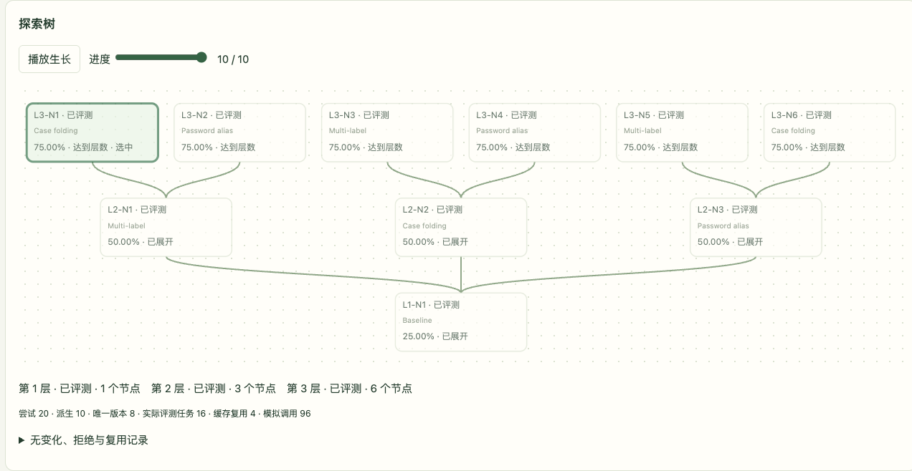

# Prompt Tree

[简体中文](README.md) · [Run the example](#see-a-tree) · [Contributing](CONTRIBUTING.md) · [MIT License](LICENSE)

Use your project's own examples to decide which prompt edit to keep. This Codex skill traces the messages your application sends to its model, runs a baseline, and tests each hypothesis on a separate branch. Open a node in the offline report to see the wording change, the failure that motivated it, and the validation score.

## See a tree

This is the HTML report from the three-level synthetic ticket experiment. The root is at the bottom. Each edge represents one edit relative to its parent. Cards show the level and node ID, evaluation state, validation score, and expansion decision. The selected version is highlighted in green.



The baseline classified 1/4 validation tickets correctly. Three edits addressed missing labels, letter case, and password synonyms. Each scored 2/4. Each parent then had two remaining error patterns, yielding six third-level candidates at 3/4. Of 20 split requests, 16 ran the local mock and four reused an identical evaluated version. [Example and scoring rule](examples/label-routing/README.md)

```sh
npm run demo
```

Open the printed `report` path to inspect each node, its evidence, and its diff.

## Install in a project

You need Codex and Node.js 22 or later. Clone the repository and copy the complete skill into the target project. Replace `/path/to/your-project` with its path.

```sh
git clone https://github.com/acse-bq23/prompt-tree.git
cd prompt-tree
mkdir -p /path/to/your-project/.agents/skills
cp -R skills/prompttree /path/to/your-project/.agents/skills/
```

Open Codex in that project and ask:

> Use $prompttree to find a prompt worth improving and design tests from existing examples. Ask me about unresolved business rules. Once they're settled, compare minimal edits and generate the prompt tree.

## How it chooses a version

1. **Choose a depth.** Codex first asks how many levels to explore. The original prompt is level 1. Each parent branches according to its own errors.
2. **Identify the prompt and scoring rule.** Codex follows the application call, checks examples and expected outcomes, and reuses or writes an evaluator. If the specification leaves partial credit undefined for a missing label, for example, it asks you to decide. Paid evaluations use the authorized budget.
3. **Establish a baseline.** Reuse existing search and validation splits, or partition examples by independent units such as tickets or conversations. The intake plan identifies missing expected outcomes or independent samples.
4. **Review a whole layer.** An active Codex session submits one background batch, waits for its completion receipt, reviews each parent, and continues to the next level. Each edge cites a parent search failure and a confirmed rule. Before evaluation, the CLI checks that the edit touches one editable field, one message, and one contiguous line hunk. A tie can keep the baseline. The report records exploratory results. Formal acceptance requires independent testing.

If the waiting client closes, reconnect with `layer-resume --run RUN --level N --wait`. Recovery reuses recorded results and collects the original evaluator receipt for an in-flight request. An unconfirmed remote outcome holds its budget pending reconciliation. A fully closed Codex session can resume from the journal when reopened. [Batch format and states](skills/prompttree/references/layers.md)

## Find your way around

| Task | Start here |
| --- | --- |
| Understand the first run in a new project | [Project intake](skills/prompttree/references/intake.md) (Chinese) |
| Connect an evaluator, examples, and scoring rules | [Configuration and results](skills/prompttree/references/contracts.md) (Chinese) |
| Check budgets or resume a run | [Recovery and budgets](skills/prompttree/references/recovery.md) (Chinese) |
| Change the code, run tests, or report a bug | [Contributing](CONTRIBUTING.md) |
