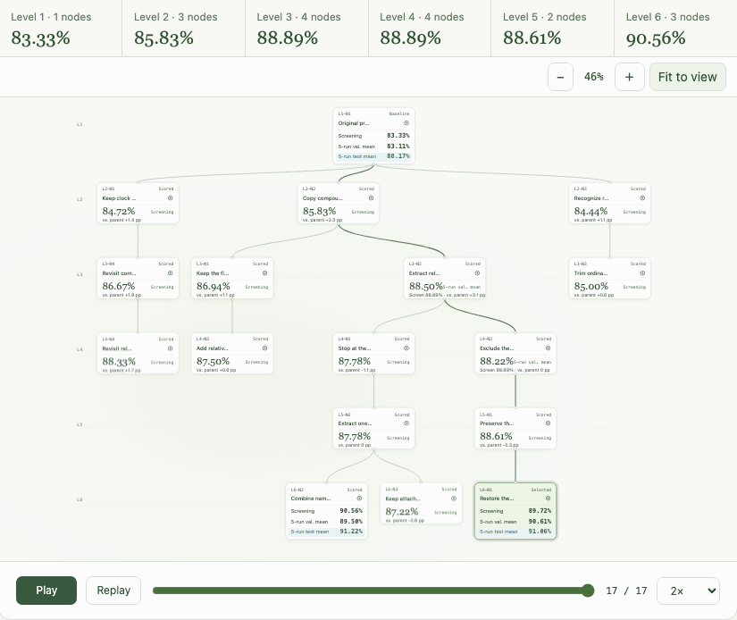

#  Prompt Tree

[简体中文](README.md) · [Example reports](examples/reports/) · [Skill instructions](skills/prompttree/SKILL.md)

Prompt Tree is a Codex skill for evaluating prompt edits on your project's own examples. It runs a baseline, proposes small changes grounded in failed cases, and records the prompts, scores and per-case differences in an interactive tree. Trace a selected version back to its source or compare two branches side by side.

## Watch a tree grow

This recording follows the Restaurant8K booking-field experiment as 17 prompt versions grow across six levels. At the end, the selected node opens to reveal its scores. L6-N1 led L6-N2 by **1.11 percentage points** on repeated validation. Their independent test means were only **0.17 points** apart.

[](examples/reports/restaurant8k.en.html)

[Open the English report](examples/reports/restaurant8k.en.html) · [中文报告](examples/reports/restaurant8k.html) · [Static overview (Chinese)](examples/reports/restaurant8k-preview.png)

## Pick an example

| What to explore | Example | What to look for |
| --- | --- | --- |
| Run the workflow locally | [Synthetic ticket routing · runnable](examples/label-routing/README.md) | Three failure patterns produce three branches. Validation goes from 1/4 to 3/4 using a local mock. |
| See why an older branch gets another try | Banking77 · [English](examples/reports/banking77.en.html) / [中文](examples/reports/banking77.html) | Round 5 branches from L2-N2 at depth 2. The new prompt fixes four validation cases and breaks nine. The earlier L2-N3 is selected. |
| Check whether the initial winner holds up | Restaurant8K · [English](examples/reports/restaurant8k.en.html) / [中文](examples/reports/restaurant8k.html) | Compare L6-N1 and L6-N2. Five validation repeats reverse the screening order. A separate test measures the gap on held-out examples. |

On GitHub, open an HTML file, choose **Download raw file**, then open the download in your browser. From a clone, open the HTML directly. Both measured reports include their data and work offline without credentials. Zoom the tree, fit it to the viewport, or select any two versions under **Prompt comparison**. Prompt text, example inputs and recorded experiment notes retain their original language. [Dataset credits, licenses and demo walkthroughs](examples/reports/README.md)

## Run a tree locally

Use Node.js 22 or later. The example runs with the Node standard library.

```sh
git clone https://github.com/acse-bq23/prompt-tree.git
cd prompt-tree
npm run demo
```

Open the file printed under `report_en` for English or `report` for Chinese. Compare the root with a child to see the instruction that changed and the tickets it fixed. For a project with an existing batch baseline, the [after-sales example](examples/after-sales/README.md) includes inputs, gold answers and an evaluator.

## Use the skill in your project

From the repository root, copy the complete skill into your target project:

```sh
mkdir -p /path/to/your-project/.agents/skills
cp -R skills/prompttree /path/to/your-project/.agents/skills/
```

Open the target project in Codex and ask, for example:

> Use $prompttree to improve the customer-support routing prompt. Explore up to six levels. Locate the actual prompt and evaluator, check the data splits and gold answers, then run a baseline. Use failed examples to propose small edits, compare the finalists and generate a report.

1. **Establish a baseline.** Identify the prompt sources, template, evaluator and metric. Split examples by independent units such as tickets or conversations. Score the original version on fixed inputs.
2. **Follow the evidence.** Each child addresses a failure mechanism observed on its parent's search split. Keep the rationale and prompt snapshot. Aim for edits within 5% of the parent text and review changes above 10%. Later proposals draw on ancestors and siblings. Older branches with complementary fixes can be revisited even after another path reaches the depth limit.
3. **Select on repeated validation.** Before locking the prompt, rerun the finalists on the same validation examples to measure variability and compare means. Set a minimum meaningful gain in advance. Within the top tier, false rejections and prompt length can decide the selection.
4. **Check the decision on held-out data.** After locking, evaluate on a separate test set to see whether the advantage carries over. Use `report-test` to attach project test receipts and inspect screening, validation repeats and independent tests in the same report.

Restaurant8K used 360 examples each for search, validation and testing. On these samples, L6-N1 led L6-N2 by **1.11 percentage points** in mean validation accuracy, clearing the preset one-point margin. On the independent test set, L6-N2 led by **0.17 points**. The test results fall in the same practical tier because the observed difference is below that margin.

## Integration and maintenance

[Project intake](skills/prompttree/references/intake.md) · [Configuration, datasets and receipts](skills/prompttree/references/contracts.md) · [Branching and revisits](skills/prompttree/references/layers.md) · [Run recovery](skills/prompttree/references/recovery.md) · [Contributing](CONTRIBUTING.md) · [MIT code license](LICENSE)
