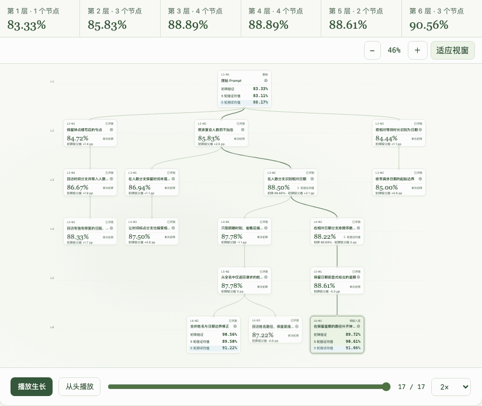

#  Prompt Tree

[English](README.en.md) · [示例报告](examples/reports/) · [Skill 使用说明](skills/prompttree/SKILL.md)

Prompt Tree 是一个 Codex Skill。它用项目自己的样例评测当前 Prompt，从答错的样本提出小改动，再把各版本的来路、分数和逐题差异放进一棵可交互的树。你可以从最终入选的版本一路追到源文件，也可以直接比较两条不同分支。

## 先看一棵树

下面是 Restaurant8K 餐厅预订字段抽取实验的实际录屏。看 17 个版本如何长成六层，再点开 L6-N1 的逐轮成绩。它在验证复测中领先 L6-N2 **1.11 个百分点**，独立测试中两版只差 **0.17 个百分点**。

[](examples/reports/restaurant8k.html)

[打开中文交互报告](examples/reports/restaurant8k.html) · [English report](examples/reports/restaurant8k.en.html) · [查看静态全图](examples/reports/restaurant8k-preview.png)

## 从一个示例开始

| 你想看什么 | 示例 | 可以验证的结果 |
| --- | --- | --- |
| 在自己的电脑上跑完整流程 | [合成工单路由 · 可运行](examples/label-routing/README.md) | 三种错误长出三条分支。验证集从 1/4 到 3/4，全程使用本地模拟模型。 |
| 为什么要回访旧分支 | Banking77 · [中文](examples/reports/banking77.html) / [English](examples/reports/banking77.en.html) | 第 5 轮从第 2 层的 L2-N2 再分叉。新分支在验证集改对 4 题、改错 9 题，最终选中较早的 L2-N3。 |
| 单次分数最高的版本是否值得锁定 | Restaurant8K · [中文](examples/reports/restaurant8k.html) / [English](examples/reports/restaurant8k.en.html) | 比较 L6-N1 和 L6-N2，观察初筛排名如何在五轮复测后反转，再看独立测试能否复现差距。 |

在 GitHub 点击 HTML 链接后，选择 **Download raw file**，再用浏览器打开；克隆仓库后也可直接双击 HTML。两份真实实验报告都内置数据，无需 API key。树支持缩放、适应视窗和节点展开，在「Prompt 对比」可以左右选择任意两版。[数据来源、许可与演示路径](examples/reports/README.md)

## 本地跑一棵树

需要 Node.js 22 或更高版本。演示使用 Node 标准库，直接运行：

```sh
git clone https://github.com/acse-bq23/prompt-tree.git
cd prompt-tree
npm run demo
```

输出中的 `report` 指向中文版，`report_en` 指向英文版。打开任一 HTML 即可查看。试着比较根节点与一个子节点，看看新增的指令修好了哪些工单。若要接入已有的批处理基线，可参考[商城售后项目的输入、金标准和评测脚本](examples/after-sales/README.md)。

## 在自己的项目中使用

从本仓库根目录把整个 Skill 复制到目标项目：

```sh
mkdir -p /path/to/your-project/.agents/skills
cp -R skills/prompttree /path/to/your-project/.agents/skills/
```

在目标项目中打开 Codex，例如输入：

> 用 $prompttree 优化这个项目的客服路由 Prompt，最多探索六层。先定位实际调用的 Prompt 和现有评分脚本，核对数据切分与金标准。跑出基线后，根据错例提出小改动，最后比较入围版本，生成报告。

1. **建立基线。** 确认 Prompt 源文件、模板、评测器和指标，按工单或会话等独立单位切分数据。用固定输入和评分器评测原版。
2. **让分支长在具体错例上。** 每个子版针对直接父版的一类探索集错误，保留修改依据和完整 Prompt。通常优先将每步改动控制在父版文本的 5% 以内，超过 10% 时复核。后续提案会查看祖先和旁支；达到深度上限后，仍可回访有互补收益的旧节点。
3. **用验证复测选版。** 锁版前让入围版本在同一批验证题上重复运行，观察波动并比较均值。预先约定什么差距值得换版。进入最高档的候选还可比较误拒率、Prompt 长度。
4. **用独立测试检验选版结果。** 锁版后用另一批留出的题检验优势能否保持。项目可通过 `report-test` 将测试回执附到同一份报告，分别查看初筛、验证复测与独立测试。

例如，Restaurant8K 把探索、验证、独立测试各固定为 360 题。在这批样本上，L6-N1 验证均值领先 L6-N2 **1.11 个百分点**，超过事先约定的 1 个百分点门槛。独立测试上，L6-N2 反超 **0.17 个百分点**，两版同档。这个门槛用于选版，**同档**表示两版的实测差距小于约定的实际提升幅度。

## 接入与维护

[首次接入](skills/prompttree/references/intake.md) · [配置、数据与评测回执](skills/prompttree/references/contracts.md) · [分支与回访规则](skills/prompttree/references/layers.md) · [恢复中断的实验](skills/prompttree/references/recovery.md) · [贡献指南](CONTRIBUTING.md) · [代码许可证 MIT](LICENSE)
